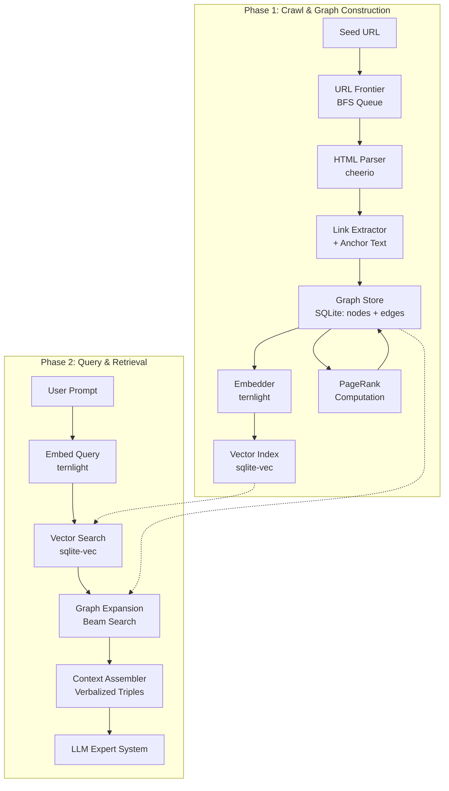

# Hypertext-Aware GraphRAG

## Introduction
Most retrieval systems treat a website as a bag of documents: chunk the text, embed the chunks, retrieve the nearest ones. This works when the content is a flat corpus, but it discards the single most valuable signal a well-structured site provides — the links themselves. When a page says "Read the deployment guide" and points to another page, that anchor text is an explicit, human-authored statement of how two concepts relate. Flattening that away means the LLM sees fragments with no idea how they connect.

This specification describes a system that does the opposite. It crawls a site from a single seed URL, reconstructs its link structure as a typed, semantically labeled graph, and retrieves from that graph using natural language. The anchor text becomes the edge label; the page content becomes the node payload. Retrieval is a local graph search — find the most semantically relevant nodes, then expand outward through labeled edges with adjustable beam width and hop depth — so the LLM receives not just relevant text but the relationships between pieces of it. The result is a context that preserves the site's own schema, letting an LLM act as an expert system that follows the graph's structure rather than guessing at it.

The implementation is deliberately minimal: one Node.js process, one SQLite file, and ternlight for on-device embeddings. No external services, no Python, no API calls, no vector database. It ingests a book-sized corpus in minutes and answers queries in under half a second, which is fast enough to sit inside an interactive agent loop.


## Technical Specification: Hypertext-Aware GraphRAG
1. Core Architecture
The system operates in two distinct phases within a single Node.js process. The Crawl Phase builds the knowledge graph from a seed URL, while the Query Phase performs local graph search to retrieve relevant context for an LLM.



The Crawl Phase (top) ingests the website, extracts its link structure, computes embeddings, and stores everything in a local SQLite database. The Query Phase (bottom) embeds the user's prompt, finds semantic seed nodes, expands through the graph using beam search, and assembles a structured context for the LLM.

2. Technology Stack (Node.js)
Component	Technology	Rationale
Crawler @crawlith/core or	Custom BFS with p-limit	Full control over traversal order, depth limits, and concurrency
HTML Parser	cheerio	Fast, jQuery-like API; parses a 10 MB page in ~2.9s
Graph Storage	better-sqlite3	Synchronous, fast, single-file; ~314K read ops/sec
Vector Index	sqlite-vec	Embedded vector search; brute-force kNN, sufficient for ≤200K embeddings
Embeddings	@ternlight/base or @ternlight/mini	5–7 MB WASM bundle, 2.5–5 ms per embed, 384-dim output, zero API calls
Graph Traversal	Custom beam search	Lightweight, adjustable width/depth, no external dependencies
Why ternlight? It distills all-MiniLM-L6-v2 into a 5–7 MB WASM bundle with ternary quantized weights, running entirely on CPU via SIMD. The base tier achieves 0.844 Spearman correlation with the teacher model and runs in ~5 ms per embedding; the mini tier runs in ~2.5 ms with slightly lower fidelity. Both output 384-dimensional L2-normalized vectors, making them drop-in compatible with cosine similarity search.

Why sqlite-vec instead of HNSW? For a dataset the size of a large book (a few thousand nodes), brute-force kNN over 384-dim vectors is fast enough (sub-millisecond) and avoids the complexity of maintaining an approximate index. The trade-off is negligible at this scale.

3. Crawl Phase: Graph Construction
Input: Single seed URL
Output: SQLite database with a typed, semantically labeled graph

```sql
-- Schema
CREATE TABLE nodes (
  id TEXT PRIMARY KEY,
  url TEXT UNIQUE,
  title TEXT,
  content TEXT,           -- extracted main text
  embedding BLOB,         -- 384-dim float32 from ternlight
  pagerank REAL DEFAULT 0,
  depth INTEGER           -- crawl depth from seed
);

CREATE TABLE edges (
  from_id TEXT,
  to_id TEXT,
  anchor_text TEXT,       -- THE semantic link label
  weight REAL DEFAULT 1.0,
  PRIMARY KEY (from_id, to_id, anchor_text)
);

CREATE INDEX idx_edges_from ON edges(from_id);
CREATE INDEX idx_edges_to ON edges(to_id);
```
Crawling algorithm:

BFS with p-limit concurrency (default: 5 parallel requests)

Respect robots.txt and Crawl-delay directives

For each page: extract a href elements and their anchor text

Compute embedding via ternlight.embed() for the extracted main content

After crawl completes, compute PageRank over the edges table

The anchor text is critical. It transforms the graph from a structural web into a semantically labeled knowledge graph. An edge labeled "Read the deployment guide" carries meaning that a bare URL cannot.

```javascript
// Embedding integration
import { embed } from '@ternlight/base'; // or '@ternlight/mini'

const embedding = embed(mainContent); // Float32Array(384), L2-normalized
db.prepare('INSERT INTO nodes (id, url, title, content, embedding) VALUES (?, ?, ?, ?, ?)')
  .run(id, url, title, mainContent, Buffer.from(embedding.buffer));
PageRank computation runs once after crawling, scoring nodes by inbound link weight:

javascript
function computePageRank(db, { damping = 0.85, iterations = 20 } = {}) {
  const nodes = db.prepare('SELECT id FROM nodes').all();
  const N = nodes.length;
  const pr = new Map(nodes.map(n => [n.id, 1 / N]));

  for (let iter = 0; iter < iterations; iter++) {
    const newPr = new Map(nodes.map(n => [n.id, (1 - damping) / N]));
    for (const node of nodes) {
      const outbound = db.prepare(
        'SELECT to_id, weight FROM edges WHERE from_id = ?'
      ).all(node.id);
      const outWeight = outbound.reduce((s, e) => s + e.weight, 0);
      if (outWeight === 0) continue;
      for (const edge of outbound) {
        newPr.set(edge.to_id, newPr.get(edge.to_id) + damping * pr.get(node.id) * (edge.weight / outWeight));
      }
    }
    pr.clear();
    for (const [k, v] of newPr) pr.set(k, v);
  }

  const update = db.prepare('UPDATE nodes SET pagerank = ? WHERE id = ?');
  for (const [id, score] of pr) update.run(score, id);
}
```
4. Query Phase: Local Graph Search
This follows the local graph search pattern from GraphRAG: find a starting point via vector similarity, then expand outward through semantically relevant relationships using beam search with score decay.

```javascript
import { embed, cosineSim } from '@ternlight/base';

async function query(userPrompt, {
  beamWidth = 3,
  maxHops = 2,
  seedCount = 5,
  contextBudget = 8000
} = {}) {

  // Step 1: Seed recall via vector similarity
  const queryEmb = embed(userPrompt); // synchronous, ~5 ms
  const allNodes = db.prepare(
    'SELECT id, url, title, content, embedding, pagerank FROM nodes'
  ).all();

  const scored = allNodes.map(n => ({
    ...n,
    sim: cosineSim(queryEmb, new Float32Array(n.embedding.buffer))
  })).sort((a, b) => b.sim - a.sim);

  const seeds = scored.slice(0, seedCount);

  // Step 2: Graph expansion (beam search with decay)
  const visited = new Set(seeds.map(s => s.id));
  let frontier = seeds.map(s => ({ ...s, hops: 0, path: [s.id], edgeLabels: [] }));
  const context = [];

  while (frontier.length > 0) {
    // Rank candidates by combined score
    const batch = frontier
      .sort((a, b) => combinedScore(b) - combinedScore(a))
      .slice(0, beamWidth);

    frontier = [];

    for (const node of batch) {
      context.push(node);
      if (node.hops >= maxHops) continue;

      // Expand via typed edges
      const neighbors = db.prepare(`
        SELECT n.*, e.anchor_text, e.weight
        FROM edges e
        JOIN nodes n ON n.id = e.to_id
        WHERE e.from_id = ?
        ORDER BY e.weight DESC
        LIMIT ?
      `).all(node.id, beamWidth * 2);

      for (const n of neighbors) {
        if (visited.has(n.id)) continue;
        visited.add(n.id);
        frontier.push({
          ...n,
          hops: node.hops + 1,
          path: [...node.path, n.id],
          edgeLabels: [...node.edgeLabels, n.anchor_text]
        });
      }
    }
  }

  return assembleContext(context, contextBudget);
}

function combinedScore(node) {
  const semantic = node.sim;                              // vector similarity
  const hopDecay = 1 / (1 + node.hops);                   // proximity
  const authority = node.pagerank || 0;                   // graph authority
  const anchorRelevance = node.edgeLabels?.length
    ? 0.1  // bonus for having labeled edges
    : 0;
  return 0.5 * semantic + 0.25 * hopDecay + 0.15 * authority + 0.1 * anchorRelevance;
}
```
Scoring weights are tunable. The defaults favor semantic similarity (0.5) while still rewarding graph proximity (0.25) and authority (0.15).

5. Context Assembly: Verbalized Triples
The key insight from hypertext-aware RAG: preserve structure through verbalization, not flattening to text chunks. Each retrieved node is presented as a graph path with its edge labels intact.

```javascript
function assembleContext(nodes, budget) {
  const paths = nodes.map(node => {
    if (node.path.length === 1) {
      return {
        text: `[${node.title}](${node.url})\n${node.content}`,
        weight: node.sim
      };
    }

    // Reconstruct path with semantic edge labels
    let pathText = '';
    for (let i = 0; i < node.path.length - 1; i++) {
      const from = nodes.find(n => n.id === node.path[i]);
      const label = node.edgeLabels[i];
      pathText += `[${from.title}] --"${label}"--> `;
    }
    pathText += `[${node.title}](${node.url})\n${node.content}`;
    return { text: pathText, weight: node.sim };
  });

  // Pack by weight until budget exhausted
  paths.sort((a, b) => b.weight - a.weight);
  let context = '';
  for (const p of paths) {
    if (context.length + p.text.length > budget) break;
    context += p.text + '\n\n---\n\n';
  }
  return context;
}
```
Example output the LLM receives:

text
[Getting Started](https://docs.example.com/start) --"Read the deployment guide"--> [Deployment](https://docs.example.com/deploy) --"Configure your environment"--> [Configuration](https://docs.example.com/config)
Configuration files are located in /etc/app/...

---

[Getting Started](https://docs.example.com/start)
Welcome to the application. This guide will walk you through...
This preserves the relational structure, allowing the LLM to reason about how information is connected, not just what the information is.

6. Adjustable Retrieval Granularity
Expose these parameters to the LLM or the application layer:

Parameter	Effect	Default	Range
beam_width	Candidates retained per hop	3	1–10
max_hops	Graph traversal depth	2	1–5
seed_count	Initial vector matches	5	1–20
context_budget	Max characters to LLM	8000	2000–32000
edge_weight_threshold	Ignore weak edges	0.3	0–1
The LLM can self-tune via tool calls: retrieve_more(entity, { beam_width: 5 }) or expand_depth(2).

7. Implementation Notes
Monolithic constraint: Single Node.js process. SQLite is embedded, ternlight runs as WASM in-process, no external services or API calls.

Performance characteristics:

Crawl: ~100 pages/minute with 5 concurrent requests (cheerio parses typical pages in <100ms)

Embed: ~5 ms per text chunk (ternlight base), ~2.5 ms (mini)

Query: <500ms for 2-hop expansion over ~5000 nodes

Vector search: brute-force kNN over 384-dim vectors, sub-millisecond for 5K nodes

Reliability:

SQLite WAL mode for concurrent reads during writes

Deterministic crawl order (BFS by depth, then URL hash)

Graph integrity checks: orphan detection, reachability from seed, duplicate edge deduplication

Data flow:

text
Seed URL → BFS crawl → parse HTML → extract text + links
         → embed text → store nodes + edges in SQLite
         → compute PageRank → ready for queries

User prompt → embed → vector search (sqlite-vec)
           → beam search expansion → context assembly
           → structured prompt → LLM
8. Cutting-Edge Alignment
This architecture incorporates several state-of-the-art patterns:

Local graph search as the retrieval primitive, not global summarization

Beam search with exponential score decay over graph depth

Verbalized triples preserving relational structure, not flattened chunks

Anchor-text-as-edge-label treating HTML links as semantic relations

On-device embeddings via ternary-quantized WASM, eliminating API latency and cost

Zero external dependencies for ML: no Python, no ONNX runtime, no model downloads

The system treats the website's link structure as a typed, semantically labeled graph and uses ternlight to make that graph queryable with natural language at interactive speed.

Choosing between ternlight tiers: Use @ternlight/base (7 MB, ~5 ms/embed, 0.844 Spearman) for server-side ingestion where quality matters. Use @ternlight/mini (5 MB, ~2.5 ms/embed, 0.820 Spearman) if embedding throughput becomes a bottleneck or if the same code might run in a browser context. Switching is a one-line import change.